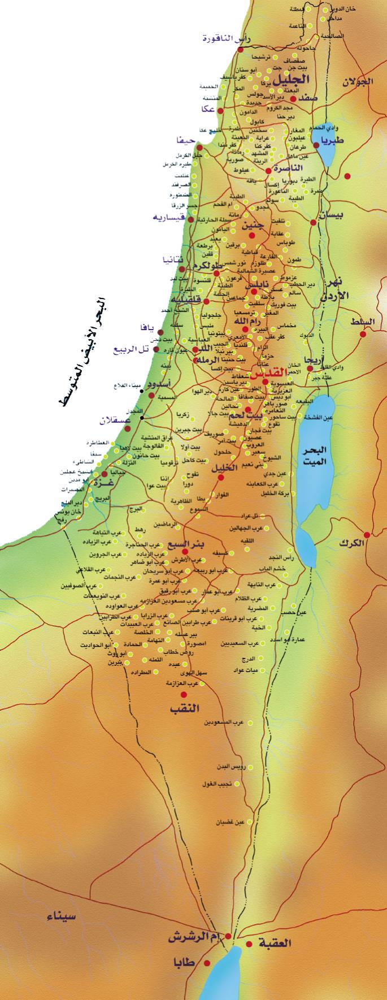

# NAV: Route Finding on a Map of Palestine (UCS & A\*)

A JavaFX desktop application I built in **October 2020** for **Introduction to Artificial Intelligence** at **Birzeit University**, taught by **Prof. Mustafa Jarrar**.

The app loads a road network of **63 towns and cities in Palestine** joined by **89 roads**, and finds a route between any two of them. You can choose between two search algorithms covered in the course: **Uniform-Cost Search (UCS)** and **A\***. The route is drawn directly on a map, and the app shows the path and its total cost.



## What the project does

1. Reads the road network from `map.txt`. Each line is `townA,townB,distance`, and each road is added in both directions.
2. Builds a weighted, undirected graph stored as adjacency lists.
3. Lets the user pick a **start town**, a **destination town**, and an **algorithm** from the GUI.
4. Runs the search and shows:
   - the sequence of towns along the path,
   - the total cost,
   - the route, drawn as line segments between the town markers on the map.

## What I implemented

- **Graph data structure from scratch:** generic `Node` and `AdjNode` classes. Edges are ordered by weight so they can be used in a `PriorityQueue`.
- **Uniform-Cost Search:** always expands the cheapest frontier node, using a priority queue keyed on accumulated path cost. It records each node's parent so the path can be rebuilt at the end.
- **A\* Search:** the same framework as UCS, plus a heuristic. The heuristic is the straight-line (Euclidean) distance between two towns, computed from their marker positions on the map and scaled to kilometres.
- **Path reconstruction:** follows parent pointers back from the goal onto a stack to rebuild the route.
- **GUI in JavaFX and FXML:** a hand-placed marker for every town on a real map image, drop-down town selectors, an algorithm toggle, and the path drawn on top of the map.
- **Data preparation:** collected the towns, their map coordinates (`towns.csv`) and the road distances between them (`roads.csv`, `map.txt`) for the area from Gaza and Hebron in the south up to Ras al-Naqoura and Safad in the north.

## What I learned

- How uninformed and informed search differ in practice. The program counts node expansions, which let me compare how UCS and A\* explore the same graph.
- How to design a heuristic. Straight-line distance is a natural choice for road maps because a road can't be shorter than the straight line between its endpoints. The heuristic must never overestimate the remaining cost, which is what **admissible** means.
- How to turn a textbook algorithm into a working program with a real dataset and a usable interface.

## Running it

**Prebuilt jar:** this needs Java 8, which includes JavaFX. Run the jar from inside its folder, because it loads `map.txt` from the current directory:

```bash
cd JarFile
java -jar JavaFXApp.jar
```

**From source:** open the project in IntelliJ IDEA with JDK 1.8 and run `sample.Main`. Run it from the project root so that `./map.txt` is found.

A short demo video is included: [`instructions.mp4`](instructions.mp4).

## Project structure

```
src/sample/
  Main.java       JavaFX entry point
  Page.java       GUI controller: loads map.txt, handles user input, draws the route, A* heuristic
  Graph.java      Graph plus the UCS and A* search algorithms
  Node.java       Graph vertex (visited flag, parent pointer, adjacency list)
  AdjNode.java    Weighted edge, comparable by weight
  page.fxml       GUI layout with a marker for each town
map.txt           Road network (townA,townB,distance)
towns.csv         Town map coordinates
roads.csv         Road distances
JarFile/          Runnable jar
```

## Looking back

This was one of my first larger programming projects. Today I would:

- reset search state between runs instead of rebuilding the graph each time,
- handle unreachable destinations gracefully,
- write unit tests that check UCS and A\* return optimal paths,
- separate the algorithm code from the GUI.

## Author

**Samer Ewidat**, Birzeit University (Student ID 1171990, Class of 2022). [LinkedIn](https://www.linkedin.com/in/sewidat/)
